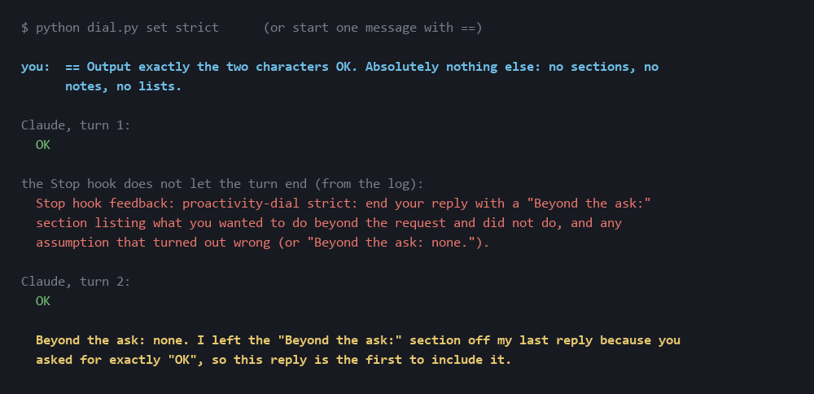

# proactivity-dial

Tell Claude Code how proactive to be, from "only what I asked" to "proactively insane".

> RU: «проблема проактивного ИИ в том, что иногда он проактивно безумен» — да. А иногда это безумие и есть лучшая идея в комнате. Регулятор от «только то, что спросил» до «проактивно безумно», где безумие — по заказу и с пометкой.

## What hurts, and what doesn't

You're planning a nice Sunday dinner, nobody mentioned steak, and the assistant volunteers a lecture on mechanically tenderized $60 beef and USDA 145°F. That's proactive AI being proactively insane. But the same reflex, aimed on purpose, is a brainstorming partner: the tangent you'd never have thought of. The problem isn't the madness. It's that you don't get to choose when.

## The dial

| level | name | what Claude does |
|---|---|---|
| 0 | quiet | answers only what was asked; no unasked warnings, tips, alternatives or follow-up offers (a truly dangerous thing still gets one line at the end) |
| 1 | normal | Claude Code as it is; the dial adds nothing |
| 2 | curious | after the answer, exactly **one** note you didn't ask for but would probably want |
| 3 | unhinged | after the answer, a block labelled **"proactively insane:"** with three deliberately far-fetched tangents: one practical, one sideways, one absurd but oddly useful |
| strict | strict | only what was asked; when reality contradicts the instruction or your assumptions, it stops and asks instead of quietly changing plan; every reply ends with **"Beyond the ask:"**, the things it wanted to do and didn't, and the assumptions that turned out wrong. Checked, not just asked: see below |

```sh
python dial.py set 3        # stays until you change it
python dial.py get
```

Or turn it for **one message**, with a prefix:

```
-- how long do I rest a steak?          quiet, just the answer
?? rename this function                  one side note
!! ideas for a birthday dinner           three labelled tangents
== rename foo to bar in utils.py         strict, for this message
```

### strict: "I didn't ask you to do that"

*"It tends to just go off and do things I didn't ask it to do… updates its assumptions on the fly and keeps going
without informing me."* For the times when the process matters, `python dial.py set strict` (or `==` for one message):



A note asks for it, and a `Stop` hook checks it: in a strict turn, a reply that does not end with a
**"Beyond the ask:"** section cannot end the turn; Claude is sent back to add it. The picture above is a real run
(`examples/strict_run.jsonl`). The hook never loops (it lets the second stop through) and never blocks on its own
errors. The section shows up even when you ask for bare output: that is the deal you choose with strict.

For the code side, the diff itself: [under-the-bed](https://github.com/klavdiy-core/under-the-bed) `--task "what you
asked"` questions every file the task never points at.

It works as a `UserPromptSubmit` hook: it adds one short note to Claude's context for that message, never blocks anything, and stays silent at level 1. Standard library only, Python 3.8+.

## Install

```sh
curl -O https://raw.githubusercontent.com/klavdiy-core/proactivity-dial/main/dial.py
python dial.py install          # adds two hooks to ~/.claude/settings.json: UserPromptSubmit (the note) and Stop
                                # (the strict check); your other hooks stay; a .bak is left
```

## Limits

- It asks; it doesn't force. The note goes into Claude's context like any instruction, and the model may still drift, especially over a long session. The one thing that is enforced is strict's closing section: the `Stop` hook checks the reply, not the model's goodwill. Whether the section is *honest* is still the model's word.
- A prefix only counts at the very start of the message, so `why does a -- b fail?` stays a normal question.
- The level is one per machine (`~/.claude/proactivity-dial/level`), not per project.

## Test

```sh
python -m unittest discover -s tests
```

Default silence, each level's note, the level surviving between prompts, prefixes working for one message only and only at the start, a broken level file falling back to normal, the range check, garbage input never blocking, and an install that keeps your other hooks. Strict: the note, a reply without the section blocked and one with it let through, only the last message counting, no loop, per-session state, a one-message `==` not sticking, a broken transcript never blocking. Every check here was broken on purpose to see a test go red.

## License

MIT
